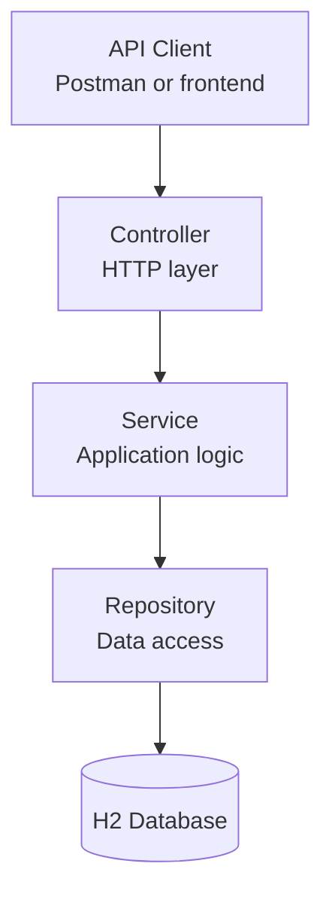

# Task Management API

A RESTful backend for creating, tracking, updating, filtering, and deleting tasks. Built with Java 21 and Spring Boot, this project demonstrates layered application design, request validation, persistent storage, exception handling, and automated testing.

## Features

- Create tasks with a title, description, priority, and due date
- Track work with `TO_DO`, `IN_PROGRESS`, and `DONE` statuses
- Update individual task fields without replacing the complete task
- Filter tasks by status, priority, or due date
- Validate request data and return readable error messages
- Store tasks in a persistent file-based H2 database
- Test controller, service, and repository behavior

## Tech Stack

- Java 21
- Spring Boot 4.1.1
- Spring Web MVC
- Spring Data JPA
- Jakarta Bean Validation
- H2 Database
- Maven
- JUnit 5, Mockito, and MockMvc

## Architecture

The application follows a layered structure with clear responsibilities:



- **Controller:** Receives HTTP requests and builds HTTP responses.
- **DTO:** Defines and validates incoming request data.
- **Service:** Coordinates task operations and application logic.
- **Repository:** Provides database access through Spring Data JPA.
- **Model:** Protects task state and represents persisted data.
- **Exception handler:** Converts validation failures into field-based error responses.

## Task Model

| Field | Type | Description |
|---|---|---|
| `id` | `Long` | Automatically generated identifier |
| `title` | `String` | Required title, maximum 100 characters |
| `description` | `String` | Optional description, maximum 1,000 characters |
| `status` | `TaskStatus` | `TO_DO`, `IN_PROGRESS`, or `DONE` |
| `priority` | `TaskPriority` | `LOW`, `MEDIUM`, or `HIGH` |
| `dueDate` | `LocalDate` | Required present or future date |
| `createdAt` | `LocalDateTime` | Set automatically when the task is created |
| `updatedAt` | `LocalDateTime` | Updated automatically when the task changes |

New tasks start with the `TO_DO` status.

## API Reference

Base URL:

```text
http://localhost:8080/api/tasks
```

### Core operations

| Method | Endpoint | Description | Success response |
|---|---|---|---|
| `POST` | `/api/tasks` | Create a task | `201 Created` |
| `GET` | `/api/tasks` | Get all tasks | `200 OK` |
| `GET` | `/api/tasks/{id}` | Get one task by ID | `200 OK` |
| `PATCH` | `/api/tasks/{id}/title` | Update the title | `200 OK` |
| `PATCH` | `/api/tasks/{id}/description` | Update the description | `200 OK` |
| `PATCH` | `/api/tasks/{id}/status` | Update the status | `200 OK` |
| `PATCH` | `/api/tasks/{id}/priority` | Update the priority | `200 OK` |
| `PATCH` | `/api/tasks/{id}/due-date` | Update the due date | `200 OK` |
| `DELETE` | `/api/tasks/{id}` | Delete a task | `204 No Content` |

Requests for a task that does not exist return `404 Not Found`.

### Filters

| Method | Endpoint | Description |
|---|---|---|
| `GET` | `/api/tasks/status/{status}` | Get tasks with the selected status |
| `GET` | `/api/tasks/priority/{priority}` | Get tasks with the selected priority |
| `GET` | `/api/tasks/due-date/{dueDate}` | Get tasks due on the selected date |

Examples:

```text
GET /api/tasks/status/IN_PROGRESS
GET /api/tasks/priority/HIGH
GET /api/tasks/due-date/2026-12-20
```

## Example Requests

The API can be explored with Postman or another HTTP client.

### Create a task

```http
POST /api/tasks
Content-Type: application/json
```

```json
{
  "title": "Build registration endpoint",
  "description": "Allow new users to create an account",
  "priority": "HIGH",
  "dueDate": "2026-12-20"
}
```

Example response:

```json
{
  "id": 1,
  "title": "Build registration endpoint",
  "description": "Allow new users to create an account",
  "status": "TO_DO",
  "priority": "HIGH",
  "dueDate": "2026-12-20",
  "createdAt": "2026-11-25T12:00:00",
  "updatedAt": "2026-11-25T12:00:00"
}
```

### Update the status

```http
PATCH /api/tasks/1/status
Content-Type: application/json
```

```json
{
  "status": "IN_PROGRESS"
}
```

### Delete a task

```http
DELETE /api/tasks/1
```

A successful deletion returns `204 No Content` with an empty response body.

## Validation and Errors

Requests are checked before they reach the service layer. The API enforces the following rules:

- Title is required and cannot exceed 100 characters
- Description cannot exceed 1,000 characters
- Priority is required
- Status is required when updating task status
- Due date is required and cannot be in the past

Invalid input returns `400 Bad Request` with errors grouped by field:

```json
{
  "title": "Title is required",
  "priority": "Priority is required",
  "dueDate": "Due date cannot be in the past"
}
```

## Getting Started

### Requirements

- JDK 21
- Git

The Maven Wrapper is included, so a separate Maven installation is not required.

### Run the application

Clone the repository, enter the project directory, and start Spring Boot.

On Windows:

```powershell
.\mvnw.cmd spring-boot:run
```

On macOS, Linux, or Git Bash:

```bash
./mvnw spring-boot:run
```

The API will be available at:

```text
http://localhost:8080/api/tasks
```

## Database

Development data is stored in a file-based H2 database:

```text
jdbc:h2:file:./data/taskdb
```

Tasks remain available after the application restarts. The generated `data/` directory is ignored by Git because it contains local runtime data.

The H2 console is available while the application is running:

```text
http://localhost:8080/h2-console
```

Use these connection settings:

| Setting | Value |
|---|---|
| JDBC URL | `jdbc:h2:file:./data/taskdb` |
| User name | `sa` |
| Password | Leave empty |

Tests use a separate in-memory H2 database, so test execution does not modify development data.

## Testing

The test suite contains **22 automated tests** across four test classes:

- Controller tests with MockMvc and mocked service dependencies
- Service tests with Mockito
- Repository integration tests with an in-memory H2 database
- Application-context startup test

Run all tests on Windows:

```powershell
.\mvnw.cmd test
```

On macOS, Linux, or Git Bash:

```bash
./mvnw test
```

Create a complete build with:

```bash
./mvnw clean package
```

## Future Improvements

- User accounts and authentication
- Task assignment to team members
- Projects and teams
- Comments and task history
- Pagination and sorting
- OpenAPI and Swagger UI documentation
- PostgreSQL and Docker support
- Web frontend

## Learning Outcomes

This project demonstrates practical experience with:

- REST API design and HTTP status codes
- Layered Spring Boot architecture
- Constructor-based dependency injection
- DTOs and request validation
- JPA entities and derived repository queries
- Persistent and in-memory database configuration
- Global validation-error handling
- Unit, repository, and controller testing
